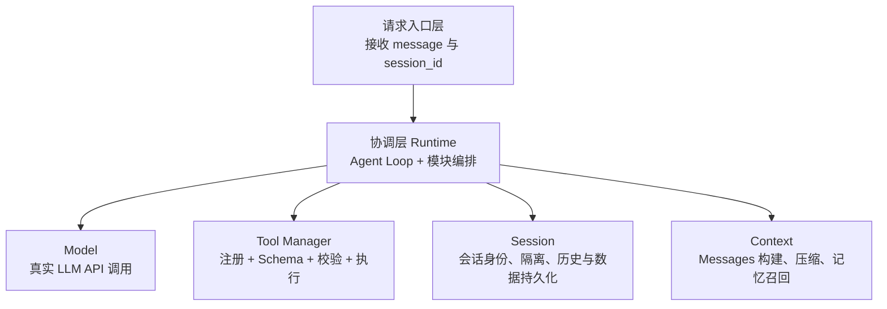

# Agent Harness｜系统架构设计 V1.0

- 日期：2026-11-10
- 阶段：窗口2｜架构设计
- 上游依据：`docs/01-requirements.md` V1.0（2026-11-09）
- 状态：**总体架构及主要策略经用户批准；细化接口与若干工程措施是候选契约，尚未编码验证；完整独立验收尚未进行。**

## 1. 目标、约束与范围

从零实现最小可用 Agent Runtime：真实 LLM 自主选择回答或调用至少三个已注册工具（包含 Todo），工具结果回到模型，支持多个隔离且可恢复的 Session、历史追问、滚动压缩、重要记忆、异常处理与可核查 Trace。

- 对应 FR-01～FR-09、NFR-01～NFR-05、DEL-01～DEL-04。
- 核心 Loop 自行实现，不使用 LangGraph / LangChain Agent / OpenHands / OpenClaw 等现成框架承载主流程。
- 当前工具选择：Calculator、Mock Search、Todo（Todo 具备增删改查）。Mock Search 明确标示模拟数据，LLM 必须是真实 API。
- 不纳入另外五道架构笔试、复杂 UI、多用户权限、向量数据库或企业级部署。

## 2. 总体逻辑架构【已批准 V0.5】



箭头为调用依赖，不表示响应或数据只能单向流动。基础能力层的 Model、Tool Manager、Session、Context 四模块**彼此不直接调用**，由 Runtime 统一协调。请求入口可以是 CLI 或 API 接口；不预设必须开发 Web 前端。

### 2.1 职责边界

| 模块 | 负责 | 不负责 |
|---|---|---|
| 请求入口 | 接收输入及 Session ID、创建会话请求的入口、展示返回状态 | Agent Loop、工具业务逻辑 |
| Runtime | 每次请求的编排、决策循环、执行预算、工具调用的上下文注入、协调历史/Trace 保存 | 具体工具函数、长期状态的最终归属、压缩算法 |
| Model | 适配真实 LLM API 请求与可见响应；把内部工具定义封装成所选 API 的格式 | 执行工具、获取隐藏推理链 |
| Tool Manager | 注册名称/描述/参数 Schema/可调用执行入口，校验并分发工具 | 自主选择 Session、决定是否继续 Loop |
| Session | Session 标识与隔离、对应数据读写、历史与 Todo 等持久化、恢复 | 选择本次发送给 LLM 的信息 |
| Context | 选择近期历史、拼装 Messages、滚动摘要、重要记忆提取与召回、长度保护 | Session 数据身份与持久化最终责任 |

## 3. 数据结构和接口契约

### 3.1 已批准的 Runtime 输入输出

- 输入：`message`（用户输入文本）和 `session_id`（会话标识）；新建 Session 的 ID 由后端创建，再在后续请求中携带，**不是 LLM 指定**。
- 输出：`session_id`、`answer`（用户可见回复）、`status`（例如 completed / failed / limit_reached）。增加后两项状态字段是 AI 建议，**已于 2026-11-10 获用户明确同意**。
- 临时运行状态：当前 Session ID、本次 Messages、模型可见响应、调用过程及 Trace、LLM 决策计数、执行状态。Runtime 不成为永久历史存储源。

以下为**候选数据结构示意**，非已确认的精确 Python 类型 / API：

```json
{
  "session_id": "A001",
  "answer": "计算结果为2，已创建待办",
  "status": "completed"
}
```

### 3.2 Session 数据【已批准】

持久化采用 **JSON 文件**；每个 Session 至少含以下数据：

```json
{
  "messages": [],
  "todos": [],
  "memory": [],
  "summary": ""
}
```

- `messages`：原始可见对话及必要工具调用 / 工具结果信息（或与压缩边界一致的可恢复历史）。
- `todos`：对应 Session 的待办数据，每条需有 Todo ID 便于更新 / 删除；对所有读改删操作同时约束 `session_id` 与 `todo_id`。
- `memory`：简短、语义完整的长期事实或约定。
- `summary`：已被移出近期模型上下文的历史滚动摘要。
- **待确认的物理组织**：每个 Session 一个 JSON 文件（`sessions/<session_id>.json`）是 AI 推荐，尚未单独批准。JSON 保存必须考虑写入中断风险；单进程顺序处理同一 Session 和临时文件替换属于待实施工程保护，不宣称已经实现。
- 为满足恢复要求，需要定义会话建立、读取及重启后恢复的具体操作和测试；跨设备恢复不在已确认范围内。

### 3.3 工具注册契约【职责已批准，具体形态待实施】

每个工具至少声明 `name`、`description`、`parameters_schema` 和关联的 Python 执行入口。模型仅获得所选 API 能接受的**工具公开定义**，不会收到 Python 函数对象。

- Model 返回工具名、调用 ID 和参数时，Tool Manager 根据名称映射执行入口并先校验 Schema。
- Runtime 从请求上下文注入 `session_id`；**不把 session_id 交由 LLM 自由决定**。
- 工具输出需要与对应的模型工具调用 ID 配对，工具调用请求与结果一同进入模型可见的当前执行 Messages。
- 根据具体供应商 API，`messages` 与 `tools` 通常是请求体不同字段；实际格式在技术选型后确认。

## 4. 主要数据流【已讨论确认，具体方法名待实施】

1. 请求入口接收用户消息及 `session_id`；不存在的 Session 不得静默串到其他 Session，创建与恢复策略由后续接口定义。
2. 请求入口调用 Runtime；Runtime 通过 Session 读取对应历史、摘要和长期记忆。
3. Runtime 将历史数据交给 Context 选择并构造本次 Messages，再从 Tool Manager 获取工具公开定义。
4. Runtime 调用 Model（真实 LLM API）获取最终文本或结构化工具调用。
5. 若有工具调用，Runtime 保留 assistant 工具调用请求，交给 Tool Manager 校验与执行；将结果 / 错误及调用 ID 写入本次 Messages；若仍有决策额度，则继续请求 Model。
6. 若收到最终回答，返回 completed；若有错误或触顶，按真实状态返回失败 / limit_reached，不伪称完成。
7. Runtime 协调 Session 保存实际发生的用户消息、assistant 工具调用、工具结果、最终答复或可恢复的失败过程；Trace 记录请求、开始执行、结果或异常。
8. 一次交互完成后检查 Context 是否达到压缩触发条件；更新 Memory、Summary 和近期上下文时，必须保证持久化更新的完整性。压缩失败保留原记录。

注意：一条模型响应可包含不止一个工具调用；8 次预算指 LLM **决策调用次数**而不是工具数量。对多工具调用的顺序/并行执行策略尚未定，MVP 可采用顺序执行。

## 5. Context 与 Memory【已批准 V0.6】

- **动态窗口**：近期窗口目标容纳 10～20 条消息；超过 20 条时，将旧消息与已有 Summary 滚动压缩，目标保留最近 10 条，之后继续累积。
- **压缩边界保护**：裁剪必须保持 assistant 工具调用与 tool 结果成组、不得制造孤立消息；10/20 是目标条数，实际边界可能略有偏差。
- **重要信息提取**：压缩旧消息前，由 LLM 从本次即将移出的旧消息中提取长期有效信息，去重并处理冲突，再用旧 Summary + 被移出的消息生成新 Summary。
- **Memory 表达**：简短但语义完整的规则 / 事实，例如“用户要求后续计算结果保留两位小数”；不是只传关键词，也不是全文重复。
- **召回**：每次模型请求注入本 Session 的**有界 Memory**，配合 Summary、近期 Messages 和当前用户输入；不从其他 Session 默认读取。
- **长度保护**：单条超长消息 / 工具输出仍可能超预算，需要长度检查及安全截断 / 压缩策略，不破坏工具调用结构。
- **失败保护**：Memory 提取或压缩调用失败时保留原历史及已确认有效数据，不先删除旧消息。

具体预算大小、摘要格式、Memory 条目数等尚未批准；可作为配置参数交任务拆解阶段做简单默认值并验证。需求 FR-06 中“第100轮仍遵守两位小数”是**待运行验收的目标**，不是已实测结果。

## 6. Agent Loop 与终止【2026-11-10 已批准】

- **单次请求最多 8 次 LLM 决策**，8 为已确认的初始配置值；每次真实模型调用消耗一次决策预算。
- **Session 对话轮次无固定上限**，通过 Context 压缩控制历史模型输入增长。
- 模型给出最终回答 → completed；模型提出工具调用 → 校验执行并反馈模型；达到预算 → 停止进一步模型 / 工具调用并返回 limit_reached。
- 达到预算时真实工具可能已经有部分副作用（如创建 Todo）；需记录实际状态，不能笼统说全部成功或全部失败。
- 工具执行错误可恢复时反馈错误给模型重试决策，但仍受次数限制。

### 6.1 候选 Runtime 流程伪代码（非完整实现）

```text
load session data → build messages and tool definitions
repeat while llm_decisions < 8:
    request model; llm_decisions += 1
    if final answer: persist visible history; return completed
    if tool calls:
        for each tool call:
            validate, execute with trusted session_id, trace
            append assistant call and paired tool result/error to messages
        continue
    otherwise: handle malformed/empty response as an error
persist truthful partial execution / errors; return limit_reached or failed
```

实现时必须避免多工具调用记录的顺序错误；模型工具调用消息通常先于对应工具结果加入 history。

## 7. 异常处理与 Trace【已批准策略】

| 场景 | 处理原则 |
|---|---|
| LLM API 超时、网络异常、无效响应 | 不伪造回复；记录明确失败状态；不无限重试 |
| 未注册工具、参数不满足 Schema | 不执行；产生可见错误结果；在剩余预算内允许模型纠正 |
| 工具抛出异常或超时 | 记录失败并反馈可恢复错误；必要时停止 |
| Todo 写入结果不确定 | 先核查真实状态，或安全停止；禁止无条件重复创建 |
| 达到 8 次模型决策 | 停止，返回 limit_reached，真实披露已执行的副作用 |
| Context 压缩失败 | 原历史保持，避免删除或覆盖有效数据 |

Trace 最低包含：session_id、可关联的 tool_call_id、工具名、必要参数（脱敏）、模型发起调用、实际开始、成功/失败/异常、结果摘要、时间信息；不能记录 API Key。Trace 与用于下次模型对话的 history 用途不同，可以关联但不等同。

## 8. 主要取舍、风险与待解决问题

### 已批准取舍

1. 请求入口 → Runtime → 四个独立基础能力模块，降低耦合；Runtime 承担更多协调代码，但 MVP 可接受。
2. JSON 持久化而非 MySQL / Redis / SQLite，优先简单和可运行；承担文件一致性与并发限制。
3. 动态窗口滚动摘要与有界 Memory，避免复杂向量检索；需要检验关键信息保真。
4. 单请求 8 次 LLM 决策上限，避免无限 Agent Loop；Session 不限制固定对话轮次。
5. 异常可恢复但有界，Todo 非幂等写入状态不确定时不盲目重试。

### 尚未决定／实现前需落实

- 真实 LLM 供应商、SDK 与工具调用消息协议；错误分类与返回状态是否增设 `partial`。
- 请求入口使用 CLI 还是 FastAPI；新建、列举及恢复 Session 的具体入口契约。
- JSON 文件路径组织、原子写及并发访问保护；`messages` 是否单独保留完整归档与压缩后的工作窗口（避免长期增长与恢复语义不清）。
- Memory 条目结构、去重 / 更新冲突策略、长度预算、压缩故障的提交顺序。
- 工具 Schema 的具体字段，Calculator 的安全计算边界、Todo CRUD 子操作的数据格式、Mock Search 样例。
- LLM 返回多个工具调用时的消息配对和顺序执行；畸形模型输出与真实 API 错误响应策略。
- Trace 文件 / 存储位置及脱敏规则；测试注入方式；重启后的 Session 隔离恢复与压缩后第100轮约定保留测试。

## 9. 验收与阶段交接

**已有独立表达证据**：用户能够描述模块划分、单向依赖、Agent Loop 数据流、Session ID 系统注入与隔离逻辑；Runtime 的接口输入由用户先提出、输出/内部状态经 AI 补充后用户批准。

**未进行**：正式架构全项独立验收、代码执行、真实 LLM 调用验证、异常注入、工具 Trace 检查与 GitHub 提交。因此不得写“项目功能已通过测试”。

向窗口3任务拆解交接：以本文件和 `docs/04-decisions.md` 为准；开发任务应先覆盖真实模型调用 + Loop + Tool Registry + Todo/Calculator/Mock Search，再覆盖 Session/Context/Memory/异常/Trace，最后进行 FR/NFR/DEL 对应测试与 README。**此顺序仅是建议，任务拆解窗口负责具体优先级和工时。**
