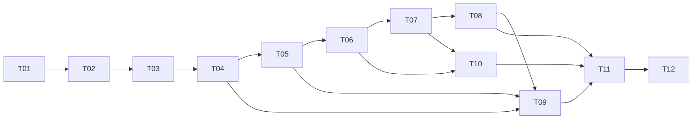

# Agent Harness｜开发任务拆解与执行计划（草案 V0.1）

- 日期：2026-11-10
- 阶段：窗口3｜任务拆解与执行计划
- 状态：**整体任务拆解仍为待审批草案。T01～T12 已完成，GitHub 发布待确认。**
- 输入依据：`docs/01-requirements.md` V1.0、`docs/02-design.md` V1.0、`docs/04-decisions.md` V1.0，以及项目负责人本轮明确批准的三个实现决策。
- 需求编号：FR-01～09、NFR-01～05、DEL-01～04 沿用需求文档，不重新定义。

## 1. 决策边界与总体策略

### 1.1 已批准、不得擅改

1. 核心 Runtime 自行实现；入口 → Runtime → Model / Tool Manager / Session / Context，四个基础模块不相互直接调用。
2. 真实 LLM 自主调用 Tool Registry 的工具；工具为 Calculator、Mock Search、Todo（CRUD）；Session ID 由可信入口/Runtime 提供而非 LLM 自选。
3. JSON 存储 `messages`、`todos`、`memory`、`summary`；多个 Session 隔离、可恢复。
4. Context 超过 20 条消息触发滚动压缩、目标保留最近 10 条，必须保留工具调用与结果配对；压缩前提取重要 Memory，每次模型请求有界注入；压缩失败保留原始有效状态。
5. 每次用户请求最多 8 次 **LLM 决策**；Session 不设固定对话轮数上限。达到限制真实说明部分副作用。
6. 有界异常处理、可审查 Trace、密钥不泄露；提交真实测试证据、README、AI 使用记录、GitHub 链接。
7. **2026-11-10 本轮新增批准**：CLI 命令行入口；配置化真实 LLM（OpenAI 兼容协议）；每 Session 一个 JSON 文件并采用安全写入。

### 1.2 仍待实现时确认（不擅自升级为“已批准”）

- 实际模型服务商、模型名、接口对 `tools` / `tool_call_id` 的支持情况与异常类型；配置项拟包含 `API_KEY`、`BASE_URL`、`MODEL`，具体字段名属实施建议。
- CLI 的命令字、参数形式、会话创建/恢复用户交互细节；建议先实现 `new`、`use <session_id>`、`send <message>` 或等效操作。
- 每 Session JSON 的严格文件路径与写入方法；建议目录限制、安全生成 Session ID、临时文件写入后原子替换、写前合法性检查。单进程串行访问同一 Session 是 **候选运行边界**；如需并发访问必须另行决策。
- 完整归档 `messages` 与被压缩工作上下文的边界；Token/字符预算、Memory 数量与冲突规则、异常状态是否增加 `partial`。这里先设置验收目标，具体默认值通过实现小决策确认。
- 工时为粗估，不代表项目已经完成；真正耗时取决于真实 LLM 接入与调试。

### 1.3 执行原则

- **纵向切片**：先验证“真实 LLM → 注册工具 → 实际执行 → 结果回传 → 最终回答”，再补齐持久化、Memory 和异常。
- **先有最低限度的可观察性**：从第一个真实工具调用开始就记录最小 Trace；后期任务补齐完整字段与故障场景。
- **每任务随做随测**：每任务生成可核查的运行证据；最终集成任务不是首次测试。
- **不删除硬性需求**：紧急情况下缩减额外功能、演示美化、复杂优化，不删除 FR/NFR/DEL。

## 2. 里程碑及关键路径

| 里程碑 | 关联任务 | 达到标志 | 估算 |
|---|---|---|---|
| M0 环境可用 | T01 | 可配置真实 API，并安全读取配置 | 0.5–1.5h |
| M1 真实 Agent 闭环 | T02–T04 | 真实模型按 Schema 调用 Calculator / Mock Search，工具结果进入后续决策，能返回答案 | 3–5h |
| M2 有状态 Agent | T05–T07 | Todo CRUD 真实执行；Session 隔离，JSON 重启恢复；能继续多轮追问 | 3.5–6h |
| M3 长对话与可靠性 | T08–T10 | 滚动压缩、Memory 保留、异常/Trace、8 次限制全部可验证 | 4–7h |
| M4 交付 | T11–T12 | 自动化与真实模型集成验证、README、AI 记录和 GitHub | 2.5–5h |

**粗估总量：13.5–24.5 小时**，不包含无法预测的模型服务接入故障和返工。建议按 M1→M2→M3→M4 逐段验收，不以估算作为进度证据。

**关键路径（概念依赖）**：T01 → T02 → T03 → T04 → T05 → T06 → T07 → T08 → T09 → T11 → T12。T10 从 T03 开始逐步实施，其最终验收并入 T11。部分小任务可穿插；依赖不意味着必须一口气写完全部先决任务。

## 3. 任务清单

> 每项均需满足 DoD、记录运行证据并经负责人确认，才可改为「已完成」。允许状态仅为：待开始 / 进行中 / 待验收 / 已完成 / 阻塞。

### T01｜项目骨架与安全配置

- **需求**：NFR-01、NFR-02、NFR-04、DEL-01。
- **目标**：建立最简 Python 项目结构、依赖清单、忽略规则、配置读取与真实 API 连通性入口。
- **输入 → 输出**：本机开发环境、模型 API 配置 → 可运行的配置检查和模型最小文本请求（不必含工具）。
- **涉及模块**：CLI 外壳、Model 配置、项目配置。
- **依赖**：无。
- **DoD**：虚拟环境可安装依赖；真实模型返回文本；密钥仅通过环境变量/非跟踪配置读取；`.gitignore` 覆盖 `.env`、Session 数据、日志/临时文件；无现成 Agent 框架承载 Loop。
- **验证**：实际启动命令+脱敏输出；缺失 API Key 时明确失败；扫描代码与 Git 跟踪文件不含真实密钥。
- **估算 / 状态**：0.5–1.5h / 已完成。

### T02｜工具注册、Schema 校验与基础工具

- **需求**：FR-02、FR-03a、FR-03b。
- **目标**：建立 `name`、`description`、`parameters_schema`、handler 注册表；实现 Calculator（安全表达式边界）与明确标记模拟数据的 Mock Search。
- **输入 → 输出**：工具名、JSON 参数、可信运行上下文 → 结构化成功结果或错误；对 Model 暴露工具公开定义。
- **涉及模块**：Tool Manager / Calculator / Mock Search。
- **依赖**：T01。
- **DoD**：合法调用正确执行；未注册工具、缺必填字段、类型不合法时拒绝执行且不崩溃；不得将 Python 可调用对象直接放进模型请求；Calculator 不使用不受控 `eval`。
- **验证**：29 项本地测试通过，覆盖 Calculator 边界、Mock Search、工具分发、Schema 校验与注册限制、JSON 结果和公开定义。见[开发日志](logs/development.md)。
- **估算 / 状态**：1–2h / 已完成。

### T03｜Model 工具协议适配与工具调用解析

- **需求**：FR-01、FR-02、NFR-02。
- **目标**：将注册表转为选定真实 API 的 tools 参数；规范化解析文本最终答复与 `tool_calls`（含 ID、名称、JSON 参数）。
- **输入 → 输出**：Messages 与工具定义 → 结构化模型决策（final / tool_calls / error）。
- **涉及模块**：Model。
- **依赖**：T01、T02。
- **DoD**：至少一次真实 LLM 返回有效工具调用；模型不提供工具调用时能解析最终文本；畸形/空输出返回明确错误，不读取隐藏推理内容；多工具调用的解析结构保留各自 ID。
- **验证**：41 项本地测试通过，并已实测 DeepSeek 普通文本和有效工具调用请求。见[开发日志](logs/development.md)。
- **估算 / 状态**：1–1.5h / 已完成。

### T04｜自主 Agent Loop 与最小 Trace

- **需求**：FR-01、FR-07、FR-09、NFR-01、NFR-05。
- **目标**：Runtime 自行协调 Model/Tool Manager，按工具调用 ID 将结果反馈模型，最多 8 次 LLM 决策；先用 Calculator / Search 构成真实闭环。
- **输入 → 输出**：`message`、可信 `session_id` → `session_id`、`answer`、`status`；同时生成基础调用 Trace。
- **涉及模块**：Runtime、Model、Tool Manager、最小 Trace。
- **依赖**：T02、T03；T05 持久化尚未实现时，可用临时 Session 占位，不宣称已达成会话恢复。
- **DoD**：模型可直接回答；至少一次真实模型自主选工具并再次获得工具结果；按响应结构正确记录 assistant 调用与 tool 结果；最多 8 次模型决策；无最终答案时返回 truthful `limit_reached`/`failed`，不伪称任务完成。模型一条响应含多个工具调用时，可顺序执行，但需完整配对。
- **验证**：50 项本地测试通过（0.487s，退出码 0）；真实 DeepSeek Calculator 闭环验证成功（模型自主调用 calculator 计算 17*(23+5) 并返回 476，Trace 记录同调用 ID）。覆盖直接回复、工具执行与回填、批次顺序与 ID 配对、第 8 次预算边界、SDK 超时与配置、Trace 脱敏。见[开发日志](logs/development.md)。
- **估算 / 状态**：1–1.5h / 已完成。

### T05｜Todo CRUD 与可信 Session 注入

- **需求**：FR-03c、FR-04、FR-05、FR-08。
- **目标**：实现 Todo 的创建、查询、更新、删除，Todo 带唯一 ID；不可由 LLM 任意指定其他 Session 的数据访问范围。
- **输入 → 输出**：CRUD 动作/目标 Todo ID/内容等参数 + Runtime 提供的可信 Session ID → 实际 Todo 状态变更及结果。
- **涉及模块**：Todo 工具、Tool Manager、Runtime 与 Session 状态接口。
- **依赖**：T02、T04；持久化接口与 T06 对接。
- **DoD**：增删改查成功及不存在目标时的失败行为一致；重复/错误 ID 不会误操作；模型不能通过工具参数越权改其他 Session；写入不确定时不得盲目重放。
- **验证**：60 项本地测试通过（退出码 0）；真实 DeepSeek 闭环验证成功（模型先调用 calculator 计算 1+1，再调用 todo 创建内容为 "2" 的待办，`TodoStore.list` 实测返回该记录、对照会话为空）。覆盖 CRUD、ID 与会话隔离、伪造会话参数、重复创建与 UUID 冲突、模型异常与预算后的状态、写后抛错与不可序列化结果。见[开发日志](logs/development.md)。
- **估算 / 状态**：1–1.5h / 已完成。

### T06｜Session JSON 隔离、创建与重启恢复

- **需求**：FR-04、NFR-03、NFR-04。
- **目标**：系统创建/读取会话；每个 Session 一个 JSON 文件保存 `messages` / `todos` / `memory` / `summary`；安全写入；CLI 选择及恢复 Session。
- **输入 → 输出**：系统生成的 Session ID、状态变更 → 有隔离的 JSON 状态及可重启恢复的 CLI 会话。
- **涉及模块**：Session、CLI、Runtime 编排。
- **依赖**：T01、T04、T05。
- **DoD**：A/B 独立创建及修改 Todo 不串扰；程序退出重启后恢复 A；非法或不存在 ID 不静默新建/混入其他 Session；写入中断不破坏现有有效文件；路径输入不可任意读写其他位置；明确当前单进程/并发运行边界。
- **验证**：87 项本地测试通过（退出码 0），覆盖 A/B 会话隔离与重启恢复、原子写入失败注入、junction/hardlink 拒绝、跨进程 CLI 往返；真实 DeepSeek 跨进程恢复验证成功。见[开发日志](logs/development.md)。
- **估算 / 状态**：1.5–2.5h / 已完成。

### T07｜多轮历史与基础 Context 构建

- **需求**：FR-05、FR-01。
- **目标**：Runtime 从 Session 加载可见历史，Context 组装当前请求，保存用户消息、工具调用与结果、最终回答。
- **输入 → 输出**：Session 存储历史 + 新消息 → 该 Session 的合法 Messages；交互后历史可保存恢复。
- **涉及模块**：Context、Session、Runtime。
- **依赖**：T04、T06。
- **DoD**：纯文本追问可获取前文；Todo 追问能定位当前 Session 的正确目标；无法确认目标时不能擅改；跨 Session 不混用历史；模型上下文中工具调用/结果不孤立。
- **验证**：87 项本地测试通过（退出码 0），覆盖历史回放、工具组配对校验、追加故障与历史协议定向修复；真实 DeepSeek 验证跨轮追问与「刚才那个」Todo 更新成功。见[开发日志](logs/development.md)。
- **估算 / 状态**：1–2h / 已完成。

### T08｜滚动摘要、Memory 提取与召回

- **需求**：FR-06、FR-05、ADR-06/07。
- **目标**：Context 超过20条消息后，压缩较旧内容并目标保留10条近期消息；提取语义完整的长期约定，注入每轮模型 Context。
- **输入 → 输出**：历史 Messages、旧 Summary、旧 Memory → 新 Summary、新 Memory、合法的近期 Messages 和本轮模型上下文。
- **涉及模块**：Context、Model（由 Runtime 调用）、Session（由 Runtime 管理持久化）。
- **依赖**：T07、T06、T03。
- **DoD**：滚动压缩按完整工具消息组裁剪；不产生孤立 tool 消息；每次模型请求包含当前 Session 的有界 Memory；重要约定如“两位小数”在压缩后仍保留；压缩或提取失败不删除旧状态；对超长单条输入/输出有明确保护，不无界增长。
- **验证**：定向测试 17 项、全量 104 项本地测试通过（退出码 0），覆盖滚动摘要、Memory 提取、分批压缩、超长工具结果与最终回答的有界截断、跨进程恢复与故障保护；真实 DeepSeek 验证合成暗号经压缩后仍可召回。见[开发日志](logs/development.md)。
- **估算 / 状态**：2–3.5h / 已完成。

### T09｜异常语义、限制与完整 Trace

- **需求**：FR-07、FR-08、FR-09、NFR-04、NFR-05。
- **目标**：完善 API/工具失败、参数错误、超时、写入不确定、压缩失败、达预算的状态与可追踪记录。
- **输入 → 输出**：可控错误/模型异常 → truthful `failed` / `limit_reached` / `completed`、不泄密的关联 Trace 与持久化真实状态。
- **涉及模块**：Runtime 主协调；Model/Tool Manager/Session/Context 各自返回错误，不互相直接调用。
- **依赖**：T04、T05、T06、T08；T04 起已经记录最低限度 Trace。
- **DoD**：记录 session_id、tool_call_id、工具名、脱敏参数、调用/执行/成功失败、结果摘要、时间；API 失败不伪造模型答复；工具参数错误可反馈模型修正但受 8 次决策限制；Todo 不确定写入不盲重试；触顶披露可能已发生的副作用；无明文 API Key。
- **验证**：独立定向测试 28 项、开发端全量 132 项本地测试通过（退出码 0），覆盖模型超时/连接/API/无效响应、工具请求/启动/结果/异常追踪、Trace 脱敏、Context 保存核查与 CLI `--trace` 正常/失败/配置错误路径的合法 JSONL 输出。见[开发日志](logs/development.md)。
- **估算 / 状态**：1.5–2.5h / 已完成。

### T10｜CLI 端到端体验与使用说明样例

- **需求**：DEL-01、DEL-02、FR-04。
- **目标**：提供无需 Web UI 的可演示入口，能创建 Session、切换/恢复 Session、输入消息和查看状态。
- **输入 → 输出**：终端输入 → 可区分 answer/status/session_id 的交互输出与使用样例。
- **涉及模块**：CLI。
- **依赖**：T04、T06；可从 T01 编写最简 CLI 外壳，最终完成在 T07 后。
- **DoD**：可按 README 中示例在干净环境运行；能区分模型最终答案、失败与限制；输入退出/切换命令不会损坏数据；不展示明文密钥。
- **验证**：定向 CLI 测试 12 项、全量 133 项本地测试通过（退出码 0），覆盖跨进程新建/切换/恢复 A/B、Todo 修改与删除、压缩后 Memory/摘要召回、Trace 事件与退出码、预算触顶与配置错误路径；PowerShell 7.6.9 实跑新建与恢复验证成功。见[开发日志](logs/development.md)。
- **估算 / 状态**：0.5–1h / 已完成。

### T11｜测试集、真实模型综合验收与缺陷修复

- **需求**：FR-01～09、NFR-01～05、DEL-04。
- **目标**：汇总此前随任务编写的确定性测试，增加真实 LLM 集成验证与最终需求覆盖矩阵。
- **输入 → 输出**：项目代码、可配置真实 LLM 与测试固定数据 → 实际测试报告/失败记录/修复记录。
- **涉及模块**：tests、全部核心模块。
- **依赖**：T01～T10。
- **DoD**：至少验证：真实工具闭环与连用；未知工具/非法 Schema；3工具与 Todo CRUD；双 Session 隔离及重启恢复；纯追问和工具追问；压缩保留 Memory；8 次上限；API/工具/存储异常及 Trace；密钥扫描；所有未通过项留痕。不将 Mock LLM 单测冒充真实模型集成测试。
- **验证**：全量 135 项、独立定向 7 项本地测试通过（退出码 0）；真实 `deepseek-flash` 探测验证 Calculator→Todo 连用与跨进程恢复（3+2 次决策）；需求覆盖矩阵及未验证项见[T11 测试报告](07-test-report.md)。真实模型连续 100 轮、全新环境在线安装明确标记未验证。见[开发日志](logs/development.md)。
- **估算 / 状态**：1.5–3h / 已完成。

### T12｜README、AI 使用记录与 GitHub 提交

- **需求**：DEL-01～04、NFR-04。
- **目标**：提交可复现代码、架构/Memory 说明、AI Prompt 和代表性问题解决记录。
- **输入 → 输出**：经过验证的项目 → GitHub 仓库链接、README、`docs/06-ai-usage.md`、测试证据及最新任务状态。
- **涉及模块**：文档、Git/GitHub。
- **依赖**：T11；README 骨架可在 T01 开始写。
- **DoD**：README 涵盖环境/安装/配置/CLI、系统架构、Session 数据、Memory **何时提取、何时召回、放在 Context 何处**、8 次决策限制、Trace/测试、已知限制；记录代表性的 AI Prompt/问题与解决方案；仓库可访问，无真实密钥和私人 Session 数据。
- **验证**：README 覆盖环境/配置/CLI、架构、Session、Memory 提取与召回、执行限制、Trace/测试及已知限制；AI 使用记录含 T06～T11 代表性工程案例与 Prompt；全量 135 项测试通过（88.236 秒，退出码 0）；四条 README CLI 命令实测复现；凭据扫描 0 命中。GitHub 仓库可访问性待远程配置后确认。
- **估算 / 状态**：1–2h / 已完成（本地验收通过，GitHub 发布待确认）。

## 4. 依赖图与阻塞传播



- **API 无法进行真实工具调用（T03 阻塞）**：M1 后续均受影响；优先验证所选服务实际支持 tools，而非先大量编写周边功能。
- **Session 读写未稳定（T06 阻塞）**：Todo 跨请求、恢复、历史、Context 持久化与压缩验收均被阻断。
- **Memory 压缩不稳定（T08 阻塞）**：可以继续补充 CLI / 文档草稿，但不能宣布 FR-06 或完整交付通过。
- **真实 API 不稳定**：确定性单测仍可推进，真实 LLM 验收保持阻塞，不可用模拟结果替代。

## 5. 时间紧张时的优先保护

1. 保住 T01–T06 的真实调用闭环与 Todo/Session 数据可靠性；它们是大部分核心功能的前置条件。
2. 紧接完成 T07–T09 的多轮、Memory/压缩、限制与异常 Trace，**这些仍是必须**。
3. T10 保持纯 CLI，不做前端；T11 聚焦覆盖硬性需求并保留真实证据；T12 README 简洁但必要项齐全。
4. 可以降低美化、复杂日志面板、高级 Memory 检索、真正联网搜索、多进程并发支持；**不能**减少三个工具、跳过真实 LLM、删掉 Session 恢复、压缩或测试。

## 6. 标准化 Claude Code 开发任务单模板

```markdown
# 开发任务单：Txx｜[名称]
- 对应需求：FR-xx / NFR-xx / DEL-xx
- 当前状态：待开始
- 上游已批准约束：[引用 01 / 02 / 04 的相关条目]
- 本任务目标：[一句话]
- 输入/输出：[接口可见行为]
- 涉及模块：[仅限哪些模块]
- 依赖任务：[已验证/未验证的编号]
- 允许修改的文件：[实施前由负责人圈定]
- 禁止事项：不得擅改已批准架构、不得泄密、不得伪造真实 LLM 测试
- Definition of Done：[可观察行为清单]
- 验证命令/案例：[可复现且包含至少一个失败案例]
- 请先给最小改动方案，再编码；完成后输出：变更文件、关键决策、实际运行命令及输出摘要、未通过项、风险。
- 预计工时：[仅供安排，不作完成证据]
- 验收人：项目负责人
```

**示例：T03 交付给 Claude Code 的最小任务指令**：

> 仅实现 Model 层 OpenAI 兼容工具调用适配。读取现有工具注册公开定义，映射为 API tools；规范解析文本答复或含 tool_call_id 的工具请求，保留多调用列表。不执行任何工具、不处理 Session/Context、不改 Runtime 架构。请给出真实模型成功返回工具调用的脱敏日志，及畸形参数/空响应的确定性测试。若当前服务不支持 tools，请停止并报告阻塞，不要模拟成真实模型成功。

## 7. 需求与任务覆盖矩阵

| 需求 | 责任任务 |
|---|---|
| FR-01 Loop | T03、T04、T05、T11 |
| FR-02 Tool Schema / Registry | T02、T03、T11 |
| FR-03 三工具（Todo CRUD） | T02、T05、T11 |
| FR-04 Session 隔离恢复 | T06、T10、T11 |
| FR-05 Context 追问 | T07、T11 |
| FR-06 压缩及 Memory | T08、T11 |
| FR-07 决策限制 | T04、T09、T11 |
| FR-08 异常 | T05、T06、T09、T11 |
| FR-09 Trace | T04、T09、T11 |
| NFR-01～05 | T01、T04、T06、T09、T11 |
| DEL-01～04 | T01、T10、T11、T12 |

## 8. 当前进度和验收记录

| 事项 | 状态 | 证据 / 说明 |
|---|---|---|
| 需求、总体架构及 ADR-01～10 | 上游文件载明已批准 | 不等于代码已实现或架构独立验收已通过 |
| CLI 入口 | 本轮明确批准 | 用户文字确认 |
| 配置化真实 OpenAI 兼容 LLM | 本轮明确批准 | T01 已用 DeepSeek 的 `deepseek-flash` 验证纯文本请求 |
| 每 Session 一个 JSON 文件、安全写入 | 本轮明确批准 | 用户文字确认；安全写入细节待实施 |
| T01 | 已完成 | DeepSeek 纯文本请求已实测，见[开发日志](logs/development.md) |
| T02 | 已完成 | 29 项测试通过，独立 Code Review 复审及项目负责人最终验收通过 |
| T03 | 已完成 | 41 项本地测试及真实 DeepSeek 工具请求验证通过，独立 Code Review 通过，项目负责人批准收尾 |
| T04 | 已完成 | 50 项本地测试通过，真实 DeepSeek Calculator 闭环验证成功，独立 Code Review 通过 |
| T05 | 已完成 | 60 项本地测试通过，真实 DeepSeek Todo 闭环验证成功，独立 Code Review 通过 |
| T06 | 已完成 | 会话 JSON 隔离与重启恢复、原子写入；独立 Code Review 通过 |
| T07 | 已完成 | 多轮历史与基础 Context、追加故障处理；独立定向复审通过 |
| T08 | 已完成 | 滚动摘要、Memory 提取、分批压缩与输出有界；独立 Code Review 通过 |
| T09 | 已完成 | 异常语义、执行限制与完整 Trace；独立复审通过 |
| T10 | 已完成 | CLI 端到端体验与使用说明样例；独立验收通过 |
| T11 | 已完成 | 测试集、真实模型综合验收与缺陷修复；独立复审通过 |
| T12 | 已完成 | README、AI 使用记录与交付文档；本地验收通过，GitHub 发布待确认 |
| 本任务拆解整体批准 | **待负责人审查** | 仅为 AI 草案 |
| 任务拆解阶段独立验收 | **尚未进行** | 尚无答题记录 |

## 9. 独立验收（不预先给答案）

由项目负责人在方案批准前或进入首任务时独立解释：

1. 为什么 T03（模型工具协议）应先于 T04（Runtime 完整闭环）？
2. 如果 T06（Session 持久化）延期，哪些功能仍能验证、哪些不能？
3. T08 压缩后首轮约定丢失，按哪项 DoD 判失败？你需要看哪些证据？
4. 如何证明工具真正调用，而非模型自己说“已调用”？
5. 时间不足时，你会删掉哪些**可选**东西，如何保护真实 LLM、Todo、Session、Context、Trace 的硬性要求？

当前结果：**尚未进行**。

## 10. 工作日志（仅记录本轮实际发生事项）

- **日期/阶段**：2026-11-10 / 窗口3任务拆解。
- **目标**：以已批准资料为基础，形成可审查的轻量开发任务草案。
- **初始思考**：项目负责人指出时间紧，允许 AI 先给轻量方案供其决策；此前 AI 提出四里程碑、初步任务顺序。
- **AI 评审**：本轮未针对用户自行撰写的完整任务表展开反例评审；已标记需提前完成真实工具调用验证、Session 隔离及随任务测试等关键风险。
- **用户决策**：批准 CLI、OpenAI 兼容协议配置化真实 LLM、每 Session 一个 JSON 文件且安全写入。
- **实际成果**：本草案 `docs/03-tasks.md` 的任务定义、依赖、验收办法和任务单模板已编制；未执行代码。
- **验证与证据**：需求/设计/决策与本轮用户决策的文档一致性人工核对；尚无运行测试证据。
- **独立验收**：尚未进行。
- **未解决问题**：供应商与模型、CLI 精确命令、并发边界、Memory 预算等具体实施决策；整体任务草案待批准。
- **下一步**：负责人审查此草案并指定 T01 开工；代码窗口先执行 T01 的最小开发任务单。

## 11. 阶段交接摘要（窗口3 → 窗口4）

- **已批准**：上游 ADR-01～10 与本轮三个实现决策；请严格维护架构分层与 Session 可信边界。
- **仍待批准**：本文件整体任务计划、个别工程细节；不得把草案写成已批准事实。
- **相关文件**：01-requirements、02-design、04-decisions、03-tasks（本草案）。
- **不得变更**：自主 Runtime Loop、真实工具调用 API、至少三个工具含 Todo、隔离恢复、Memory/压缩、8 决策上限、真实异常与 Trace、安全密钥处理。
- **首个建议开发任务**：T01；开始前展示可执行的最小修改计划、受影响文件和验证方法。
- **当前开发进度**为 T01～T12 已完成，GitHub 发布待确认。运行证据见[开发日志](logs/development.md)。
